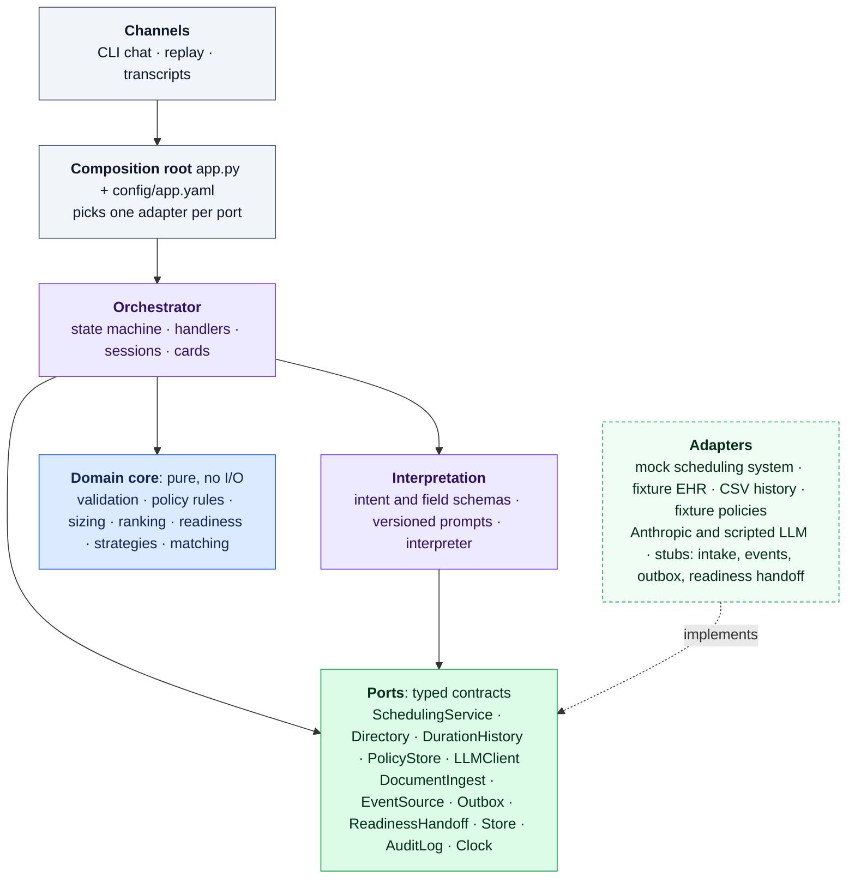

# AI-assisted OR case booking

Prototype for the Qventus AI Solution Architect challenge (workflow: **operating room scheduling**). An agent turns OR case requests arriving by fax, email, phone or chat into complete, compliant bookings.

- **The language model interprets and communicates.** It reads requests into fields and phrases short replies.
- **Deterministic code decides.** Validation, hospital rules, availability, ranking and every commit run in code.
- **The coordinator confirms every booking.**

It runs against a simulated hospital (Northwind Regional Medical Center), with Claude Opus 5.5 live or a scripted model offline.

## Where each deliverable is

| The assignment asks for | Where |
|---|---|
| Flow diagram or outline, happy and alternate paths | [docs/diagrams/booking_flow.md](docs/diagrams/booking_flow.md): intake and routing, the booking core, the conversation state machine (generated from the code), and two sequence diagrams |
| Conversation modeling technique | A state machine: 20 states, 35 transitions, defined in [transitions.py](src/or_booking/orchestrator/transitions.py) ([below](#conversation-model)) |
| Key intents and entities | [Intents and entities](#intents-and-entities), below; defined once in code |
| Prototype: route intents, capture slots, call a backend | This repository; [Quick start](#quick-start); transcripts of every demo run in [docs/demo/](docs/demo/README.md) |
| Written notes on optimization and scalability | [docs/optimization_and_scalability.md](docs/optimization_and_scalability.md) |
| Where AI assistants were used | [Where AI assistants were used](#where-ai-assistants-were-used), below |
| Optional: multi-turn clarification | D1 (which patient), D6 (side conflicts with the surgeon's order), parked questions answered by a later fax |
| Optional: RAG for policies | Designed ([notes](docs/optimization_and_scalability.md#leverage-ragvector-databases-for-external-knowledge)); the `PolicyStore.search` port is a stub |

Background: [problem statement](docs/problem_statement.md), [implementation plan](docs/implementation_plan.md), and the [research reports](docs/reports/).

## Quick start

Python 3.11+ and [uv](https://docs.astral.sh/uv/).

```bash
uv venv
```

```bash
uv pip install -e ".[dev]"
```

Replay scenario D1 end to end, offline: a faxed request with two patients named Maria Gomez becomes a booking.

```bash
.venv/Scripts/or-booking replay d1
```

Step through the same conversation yourself (Enter sends the next coordinator turn; `/help` lists commands such as `/schedule`, `/drafts` and `/audit`):

```bash
.venv/Scripts/or-booking chat --scenario d1
```

**With the real model.** Copy `.env.example` to `.env` and set `ANTHROPIC_API_KEY` (`.env` is gitignored). Then add `--live` to `replay` or `chat`. A live D1 run makes 5 model calls, about 13k input and 1.8k output tokens. `chat --live` without `--scenario` lets you type any request.

```bash
.venv/Scripts/or-booking replay d1 --live
```

Other commands:
- `schedule`: the simulated week, rooms by day
- `availability`: send an availability query straight to the scheduling service
- `ports`: which adapter backs each port
- `diagram`: the state diagram generated from the code
- `transcripts`: regenerate `docs/demo/`

## Demo scenarios

| | What happens | Ends in |
|---|---|---|
| [D1](docs/demo/d1_faxed_request.md) Faxed request ([live run](docs/demo/live/d1_faxed_request.md)) | The fax is read; two patients share the name, so the options come with a date-of-birth question; the coordinator answers and picks; confirmed and booked | Booked, readiness list handed off |
| [D2](docs/demo/d2_other_owners_block.md) Other owner's block ([live run](docs/demo/live/d2_other_owners_block.md)) | The coordinator asks for Wednesday, in Dr. Ruiz's and Dr. Chen's unreleased blocks; the agent gives the release times and drafts release requests | Waitlisted |
| [D3](docs/demo/d3_slot_taken.md) Slot taken ([live run](docs/demo/live/d3_slot_taken.md)) | Another coordinator holds Tuesday between search and pick; the hold fails, the agent searches again and books Thursday; a retried commit and a double "confirm" create no duplicate | Booked, one case |
| [D4](docs/demo/d4_urgent.md) Urgent ([live run](docs/demo/live/d4_urgent.md)) | "Needs a room tonight" goes to the anesthesiologist in charge and the OR desk with a structured handoff | Routed out, nothing booked |
| [D5](docs/demo/d5_clinical_question.md) Clinical question ([live run](docs/demo/live/d5_clinical_question.md)) | "Is Maria Gomez fit for general anesthesia?" goes to the surgeon's office | Routed out, nothing booked |
| [D6](docs/demo/d6_side_conflict.md) Side conflict ([live run](docs/demo/live/d6_side_conflict.md)) | The email says left knee; the surgeon's order says right; the agent asks, the coordinator confirms right | Booked on the right side |
| [D7](docs/demo/d7_cardiac_stub.md) Cardiac case ([live run](docs/demo/live/d7_cardiac_stub.md)) | The ICU post-op destination selects OR-plus-ICU-bed booking, a stub, which routes to the coordinator | Routed out, nothing booked |

Each scenario is a YAML file in `scenarios/demo/` and a golden test. Each has also passed a live run with the real model; the live transcripts are in [docs/demo/live/](docs/demo/live/).

## Architecture in one page

Three principles shape everything:
1. **The model interprets and communicates; code decides.**
2. **The hospital's rules are the hospital's data.** Release horizons, schedule close, readiness deadlines, routing and autonomy live in the simulated hospital's systems and policy files ([fixtures/](fixtures/README.md)), never in the agent's configuration.
3. **Design the whole problem, build one path.** Every input type, service line and integration has a named interface. One path is built end to end; the rest are explicit stubs.



The dependency rule is enforced by import-linter contracts, which run inside the test suite:
- the domain imports nothing outside itself
- the orchestrator never imports an adapter or a vendor SDK
- only the composition root imports adapters
- only the Anthropic adapter imports the Anthropic SDK

**One turn.**
1. The session is loaded.
2. One model call interprets the message or extracts the document into *proposed* values, with the exact words each came from.
3. The state machine runs until it reaches a state that waits. Handlers call the domain and the ports, and values become *resolved* only through lookups, the surgeon's order or validation.
4. The reply is cards built from state, plus at most one model-phrased line.
5. The session is saved, and every transition, model call and port call is in the audit log.

**What the flow itself guarantees, at any hospital:**
- Every commit passes through a confirmation step, against a time-limited hold, with a retry-safe idempotency key.
- The model proposes; the state machine decides. Identifiers only ever come from lookups, so text in a fax can't steer the flow.
- Every step is recorded.

Everything else is the hospital's policy, which the agent follows: urgent cases go to the anesthesiologist in charge, clinical questions to the surgeon's office, two patient identifiers are required, and so on.

**Built and stubbed.**

| Integration (port) | Prototype adapter | Status |
|---|---|---|
| Scheduling system | In-memory mock: block release, schedule close, turnover, shared robots, 10-minute holds, idempotent confirms, typed errors | Built (mock) |
| EHR directory, payers, credentialing, procedure master | Fixture files | Built (fixture) |
| Duration history | CSV of 154 past cases | Built |
| Hospital policies | Four rule types (booking data, readiness, routing, autonomy) as YAML | Built; passage search is a stub |
| Language model | Claude Opus 5.5 via the Anthropic SDK; a scripted model for replay | Built |
| Session store, audit log, clock | Memory or SQLite; JSON lines; frozen clock | Built |
| Fax OCR, email, call transcription | Pre-transcribed text | Stub |
| Scheduling events (HL7 SIU) | Injected events | Stub |
| Notifications | Drafts only, never sent | Stub |
| Readiness follow-up | Recorded handoff | Stub |

| Domain seam | Status |
|---|---|
| Booking strategy, chosen from procedure attributes | `standard` built; `bed_coupled` (OR plus ICU bed), `tandem` (paired rooms) and `reserve_and_preempt` (emergencies) are stubs that route by policy |
| Straight-through (Tier 3) booking | Built, in shadow mode: reports whether a request would have qualified, never acts |
| Change impact, site-of-service eligibility | Stubs |

## Conversation model

The conversation is a state machine. The [transition table](src/or_booking/orchestrator/transitions.py) is the single source:
- **The diagram:** `or-booking diagram` generates the state diagram in [booking_flow.md](docs/diagrams/booking_flow.md#3-conversation-state-machine), and a test fails if the document drifts from it.
- **Handlers:** each state has one handler in [handlers.py](src/or_booking/orchestrator/handlers.py); a handler can move a request only along an edge in the table.
- **Coverage:** nineteen test flows exercise all 35 transitions, and a test fails if any transition goes unused.

Key behaviors:
- **Waiting states:** `Presenting` waits for a pick, `Confirming` for a confirmation, and `Clarifying` for an answer. `AwaitingReply` parks a request whose question went to an office by fax or email.
- **Running straight through:** states that don't wait run through, so one message can move a request through several states.
- **Messages that don't fit:** an intent that doesn't fit the current state doesn't move the request. "Confirm" while options are on screen does nothing; the reply says what's needed.

## Intents and entities

**Intents** ([schemas.py](src/or_booking/interpretation/schemas.py)):

| Group | Intents |
|---|---|
| New case | `new_request`, `ask_availability` |
| In a conversation | `provide_info`, `select_option`, `confirm`, `correct`, `request_waitlist`, `request_release` |
| About a booked case | `ask_status`, `modify_case`, `cancel_case`, `readiness_update` |
| Routed to a person by policy | `urgent_request`, `clinical_question`, `talk_to_human` |
| Fallback | `unclear` |

**Entities: the fields a request carries** (`BookingField` in [models.py](src/or_booking/domain/models.py)):
- surgeon, procedure, side (laterality), date window
- patient name and date of birth
- diagnosis, anesthesia type, patient class
- implants, authorization, preferences
- case number, contact

Each field's definition lives in code, and the prompts' field list is generated from it. Resolved, a field becomes an identifier from the hospital's records: surgeon id, procedure id, patient MRN, ICD-10 code.

Two requests go to the scheduling system, each with only what that step needs:
- **The availability query:** surgeon, procedure, case length (typical and long, sized from the surgeon's history) and date window.
- **The booking request:** the chosen option plus the hospital's required booking data.

## Prompts and the model

Five versioned prompts in [prompts/](prompts/) share fragments for role, reading rules, writing rules and the data boundary.

| Prompt | When | Returns | Effort |
|---|---|---|---|
| `extract_document` | A fax, email or call arrives | Intent, every field found with its verbatim evidence, the sender | medium |
| `interpret_turn` | Each coordinator message | Intent, field values, corrections, the option picked, anything unclear | medium |
| `ask_clarification` | The code has picked one issue to ask about | One question | low |
| `explain_options` | Options are shown | At most two sentences on the trade-off | low |
| `summarize_outcome` | A booking finishes | Two or three sentences | low |

How the model is called:
- **Model:** Claude Opus 5.5 (`claude-opus-5-5`), configurable per prompt in [config/app.yaml](config/app.yaml).
- **Structured outputs:** responses are constrained to the Pydantic schemas.
- **Caching:** system prompts are stable and cached.
- **Refusals and truncation:** `stop_reason` is checked first; a refused or truncated response is never used. Server-side refusal fallbacks are on.
- **Failures:** any unusable output becomes a question for the coordinator.
- **What the model never does:** check feasibility, rank, validate, produce an identifier or decide to commit. The confirmation card is built from validated state, not from model text.

## Testing

```bash
.venv/Scripts/python -m pytest
```

235 offline tests:
- table-driven domain tests
- contract suites per port, run against every adapter that implements them
- orchestrator flows covering every transition
- a stubbed SDK client for the Anthropic adapter
- golden replays of every demo scenario
- drift tests for the state diagram and the transcripts
- the layering contracts

Seven more tests run the demo scenarios against the real model, only when asked for (about $0.50):

```bash
OR_BOOKING_LIVE=1 .venv/Scripts/python -m pytest -m live
```

## Where AI assistants were used

**To build it.** Claude Code (Claude Opus 5.5) was used throughout, working from the author's direction:
- **Design documents:** the research reports and notes, the problem statement, the flow diagrams and the implementation plan.
- **The prototype:** all code, tests, fixtures, scenarios and prompts, built phase by phase from the plan's build order.

The author chose the workflow and set the scope and principles:
- design the whole problem, then build one path and stub the rest
- hospital rules belong to the hospital's data, not the agent's configuration
- the build order, with the eval suite last

The author also made the decisions recorded in the plan and reviewed each phase. The simulated hospital (patients, surgeons, schedules, policies, faxes and emails) is synthetic and was written with AI; there is no real patient data.

## Status

Built through Phase 6 of the [build order](docs/implementation_plan.md#71-phases), the plan's cut line for a complete submission.

**Known gaps:**
- stated preferences such as "not Mondays" are recorded but don't narrow the search
- change-impact analysis is a stub
- the mock scheduling system keeps its state in memory, so a session lives within one process
- no real EHR adapter exists yet

**Next, in the plan's order:**
1. a Streamlit view of the state machine and cards
2. scenarios D8 (a late fax reply) and D9 (a bumped case re-booked)
3. policy questions answered from the prose policies
4. last, the generated eval suite

## Repository layout

```text
config/app.yaml          agent settings only: adapter per port, model and effort per prompt
fixtures/                the simulated hospital: scheduling system, EHR, policies, inbox
prompts/                 versioned prompt templates and shared fragments
scenarios/demo/          one YAML file per demo conversation
src/or_booking/
  domain/                pure logic: models, policy rules, validation, sizing, ranking, readiness, strategies, matching
  ports/                 typed contracts (Protocols) for every integration
  adapters/              mocks, fixture readers, the Anthropic and scripted LLMs, stubs
  interpretation/        schemas, prompt registry, interpreter
  orchestrator/          states, transition table, handlers, router, sessions, cards, engine
  channels/              CLI, scenario runner, transcripts
  app.py                 composition root
tests/                   unit, contract, adapters, orchestrator, golden, live
docs/                    problem statement, plan, diagrams, notes, demo transcripts, research
scripts/                 the case-history generator
```
