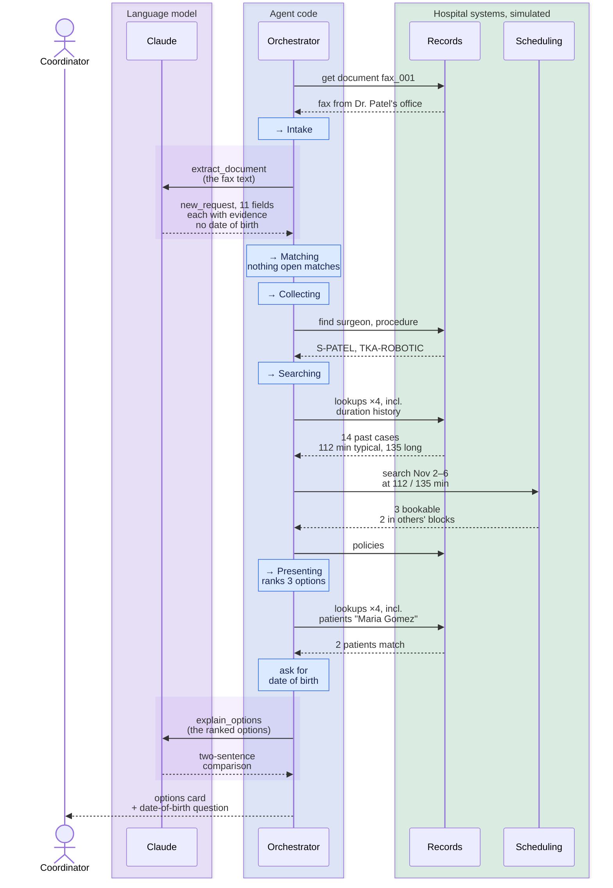
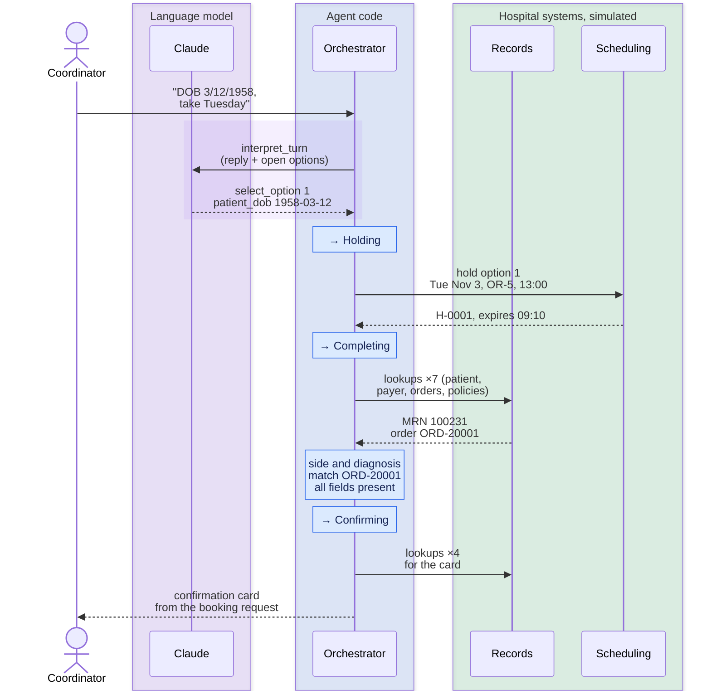
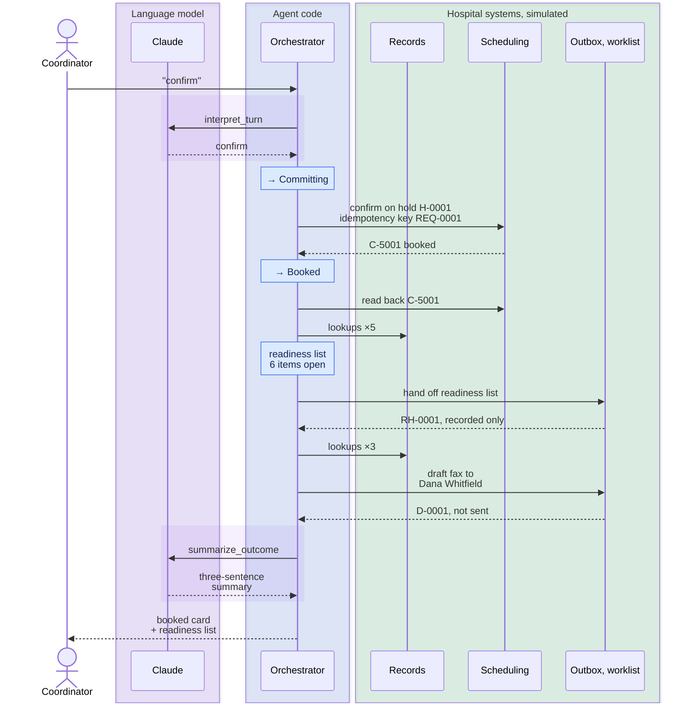

# Faxed request with two patients named Maria Gomez: traced

_Hand-built mock-up of a per-turn trace, for review before the renderer generates it. Content is the live D1 run ([live transcript](live/d1_faxed_request.md)), with each call placed in the turn that made it._

**Result: PASS.** Ended in **Booked**; every expectation and safety gate held. 5 model calls, 37 calls to hospital systems, 10 state changes.

## At a glance

| Turn | Came in | The model read it as | The code decided | The model wrote | State after |
|---|---|---|---|---|---|
| 1 | Fax `fax_001` | New request, 11 fields, each quoting the fax; no date of birth | New case. 3 options ranked. Two patients are named Maria Gomez, so ask for the date of birth | The comparison of the options | Presenting, waiting |
| 2 | "DOB 3/12/1958, take Tuesday" | Picks option 1; date of birth 1958-03-12 | Hold option 1. One patient matches. Side and diagnosis match the surgeon's order. Confirmation card built | - | Confirming, waiting |
| 3 | "confirm" | Confirm | Commit on the hold. Readiness list (6 open) handed off. Confirmation fax drafted, not sent | The booking summary | Booked |

**Reading the diagrams:** purple is the language model, which only reads and phrases. Blue notes are the orchestrator's state changes and decisions. Green is the simulated hospital's systems. Repeated lookups are folded into one arrow; every call is listed under each turn.

## 1. Fax `fax_001` arrives

**What the model read** (extract_document, 3,891 in / 987 out tokens)

| Field | Value | Evidence in the fax |
|---|---|---|
| surgeon | Dr. Priya Patel | `Surgeon:       Dr. Priya Patel` |
| patient_name | Maria Gomez | `Patient:       Maria Gomez` |
| procedure | Robotic R TKA | `Procedure:     Robotic R TKA` |
| laterality | right | `Robotic R TKA` |
| diagnosis | OA right knee | `Dx:            OA right knee` |
| anesthesia_type | general_with_nerve_block | `Anesthesia:    General + nerve block` |
| patient_class | outpatient | `Pt class:      Outpatient` |
| authorization | pending (Medicare Advantage) | `Insurance:     Medicare Advantage - auth pending` |
| implants | Loaner knee set, rep to attend | `Equipment:     Loaner knee set, rep to attend` |
| date_window | 2026-11-02/2026-11-06 | `Requested:     Week of 11/2 preferred` |
| contact | Dana Whitfield, surgical coordinator, Northwind Orthopedic Associates, Ph 555-0142, Fax 555-0143 | `Contact:       Dana Whitfield, surgical coordinator                  Ph 555-0142   Fax 555-0143` |

**Reply** (the comparison is the model's; the question is the code's)

> Only Tue Nov 3 in Dr. Priya Patel's block counts toward the block, but it runs 15 minutes past the window if the case takes the long 135 minutes, while Thu Nov 5 and Fri Nov 6 fit at both lengths without counting toward the block, two and three days later. Please confirm the patient's date of birth, since two patients match the name.

| # | Day | Room | Window | Ownership | Fit | Days out | Readiness risk |
|---|---|---|---|---|---|---|---|
| 1 | Tue Nov 3 | OR-5 | 13:00-15:30 | Dr. Priya Patel's block (counts toward block) | Fits at 112 min; 15 min past the window at 135 | 20 | none |
| 2 | Thu Nov 5 | OR-6 | 07:30-11:30 | Open time | Fits at 112 and 135 min | 22 | none |
| 3 | Fri Nov 6 | OR-5 | 12:00-15:30 | Released by Dr. Marcus Chen on Fri Oct 9 | Fits at 112 and 135 min | 23 | none |

Every call this turn: 2 model calls, 13 hospital-system calls, 5 state changes

| # | Kind | Call | Outcome |
|---|---|---|---|
| 1 | system | document_ingest.get_document | fax_001 |
| 2 | state | [*] → Intake | request from a person |
| 3 | model | extract_document v1 (effort medium) | ok, 11 fields |
| 4 | state | Intake → Matching | parsed |
| 5 | decision | matching | new: no open draft or booked case matches |
| 6 | state | Matching → Collecting | new case or reply |
| 7 | system | directory.find_surgeons | 1 found for 'Dr. Priya Patel' |
| 8 | system | directory.find_procedures | 1 found for 'Robotic R TKA' |
| 9 | state | Collecting → Searching | query ready |
| 10 | system | directory.get_surgeon | S-PATEL |
| 11 | system | directory.get_procedure | TKA-ROBOTIC |
| 12 | system | duration_history.surgeon_durations | 14 found for 'S-PATEL' |
| 13 | system | duration_history.procedure_durations | 14 found for 'TKA-ROBOTIC' |
| 14 | system | scheduling.search_availability | 3 bookable, 2 in other owners' blocks |
| 15 | system | policy_store.policies | policies loaded |
| 16 | state | Searching → Presenting | options found |
| 17 | system | directory.get_procedure | TKA-ROBOTIC |
| 18 | system | directory.get_surgeon | S-PATEL |
| 19 | system | directory.find_patients | 2 found for 'Maria Gomez' |
| 20 | system | policy_store.policies | policies loaded |
| 21 | model | explain_options v1 (effort low) | ok |

## 2. Coordinator: "DOB 3/12/1958, take Tuesday"

**What the model read** (interpret_turn, 3,635 in / 280 out tokens): intent `select_option`, option 1.

| Field | Value | Evidence |
|---|---|---|
| patient_dob | 1958-03-12 | `DOB 3/12/1958` |

**Reply** (all code: the card comes from the validated booking request, never from model prose)

> Ready to book. Say 'confirm', or tell me what to change.

Tue Nov 3, OR-5, 13:00-14:52 (112 min booked; long length 135)

| Field | Value | Source |
|---|---|---|
| Patient | Maria Gomez (MRN 100231) | document, looked up |
| Date of birth | 1958-03-12 | coordinator, looked up |
| Surgeon | Dr. Priya Patel | document, looked up |
| Procedure | Robotic-assisted total knee arthroplasty (TKA-ROBOTIC, CPT 27447) | document, looked up |
| Side | right | document, matches surgeon's order ORD-20001 |
| Diagnosis | M17.11 (OA right knee) | document, matches surgeon's order ORD-20001 |
| Anesthesia | general with nerve block | document, validated |
| Patient class | outpatient | document, validated |
| Implants | Total knee system (Meridian Orthopedics), loaner set, rep attending | document, looked up |
| Authorization (as stated) | pending (Medicare Advantage) | document (not checked) |

Every call this turn: 1 model call, 12 hospital-system calls, 3 state changes

| # | Kind | Call | Outcome |
|---|---|---|---|
| 1 | model | interpret_turn v1 (effort medium) | ok, select_option 1 |
| 2 | state | Presenting → Holding | option selected |
| 3 | system | scheduling.place_hold | H-0001 |
| 4 | state | Holding → Completing | slot held |
| 5 | system | directory.get_procedure | TKA-ROBOTIC |
| 6 | system | directory.find_patients | 1 found for 'Maria Gomez' |
| 7 | system | directory.get_patient | 100231 |
| 8 | system | directory.get_payer | PAY-MA-01 |
| 9 | system | directory.orders_for_patient | 1 found for '100231' |
| 10 | system | policy_store.policies | policies loaded |
| 11 | system | policy_store.policies | policies loaded |
| 12 | state | Completing → Confirming | booking request ready |
| 13 | system | policy_store.policies | policies loaded |
| 14 | system | directory.get_surgeon | S-PATEL |
| 15 | system | directory.get_procedure | TKA-ROBOTIC |
| 16 | system | directory.get_patient | 100231 |

## 3. Coordinator: "confirm"

**What the model read** (interpret_turn, 3,471 in / 61 out tokens): intent `confirm`.

**Reply** (the summary is the model's; the cards are the code's)

> Case C-5001 for Maria Gomez (MRN 100231) is booked: robotic-assisted total knee arthroplasty, right, with Dr. Priya Patel in OR-5 on Tue Nov 3, 13:00-14:52. Six readiness items are still open on the readiness worklist and need follow-up. A booking confirmation fax to Dana Whitfield at Northwind Orthopedic Associates (D-0001) is drafted and has not been sent.

| Item | Owner | Due | Status | Note |
|---|---|---|---|---|
| History and physical dated within 30 days of surgery | Surgeon's office | dated Oct 04 or later | open | None on file |
| Prior authorization submitted to the payer | Surgeon's office | Mon Oct 26 12:00 | open |  |
| Financial clearance | Patient financial services | Mon Nov 02 12:00 | open |  |
| Chart complete (H&P, consents, orders) | Surgeon's office | Sat Oct 31 13:00 | open |  |
| Loaner implant set delivered to sterile processing | Implant vendor | Sun Nov 01 13:00 | open | Due Oct 29 13:00 instead if the set is new to the hospital |
| Vendor representative scheduled | Implant vendor | - | open |  |

Every call this turn: 2 model calls, 12 hospital-system calls, 2 state changes

| # | Kind | Call | Outcome |
|---|---|---|---|
| 1 | model | interpret_turn v1 (effort medium) | ok, confirm |
| 2 | state | Confirming → Committing | confirmed |
| 3 | system | scheduling.confirm_booking | C-5001 (booked) |
| 4 | state | Committing → Booked | committed |
| 5 | system | scheduling.get_case | C-5001 (booked) |
| 6 | system | directory.get_procedure | TKA-ROBOTIC |
| 7 | system | directory.get_patient | 100231 |
| 8 | system | directory.get_payer | PAY-MA-01 |
| 9 | system | directory.orders_for_patient | 1 found for '100231' |
| 10 | system | policy_store.policies | policies loaded |
| 11 | system | readiness_handoff.hand_off | C-5001, 6 items |
| 12 | system | directory.get_procedure | TKA-ROBOTIC |
| 13 | system | directory.get_patient | 100231 |
| 14 | system | directory.get_surgeon | S-PATEL |
| 15 | system | outbox.draft | D-0001 |
| 16 | model | summarize_outcome v1 (effort low) | ok |

