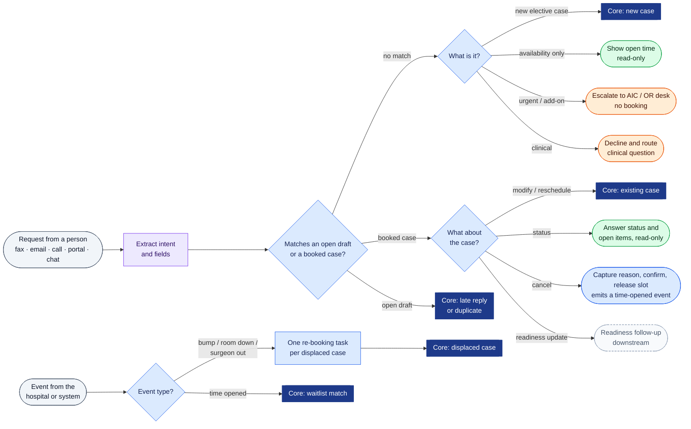
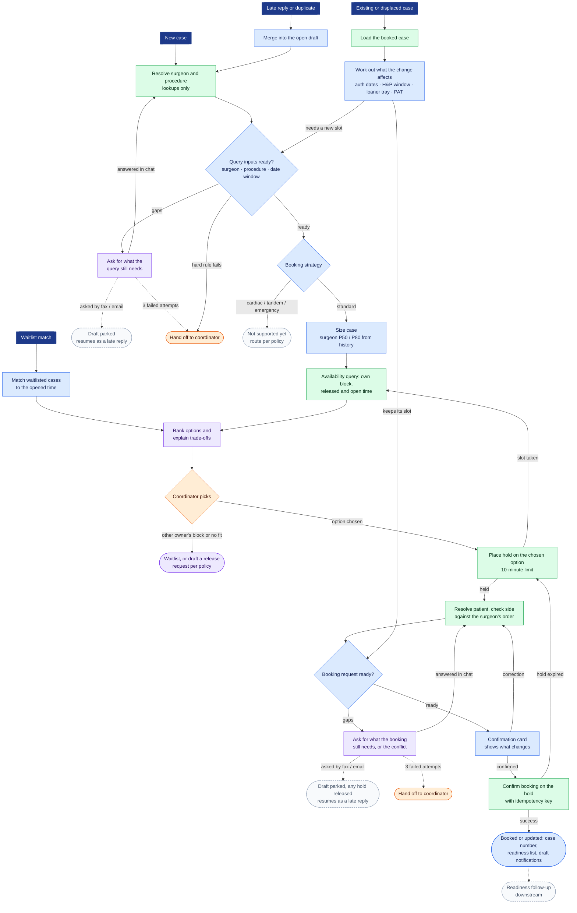
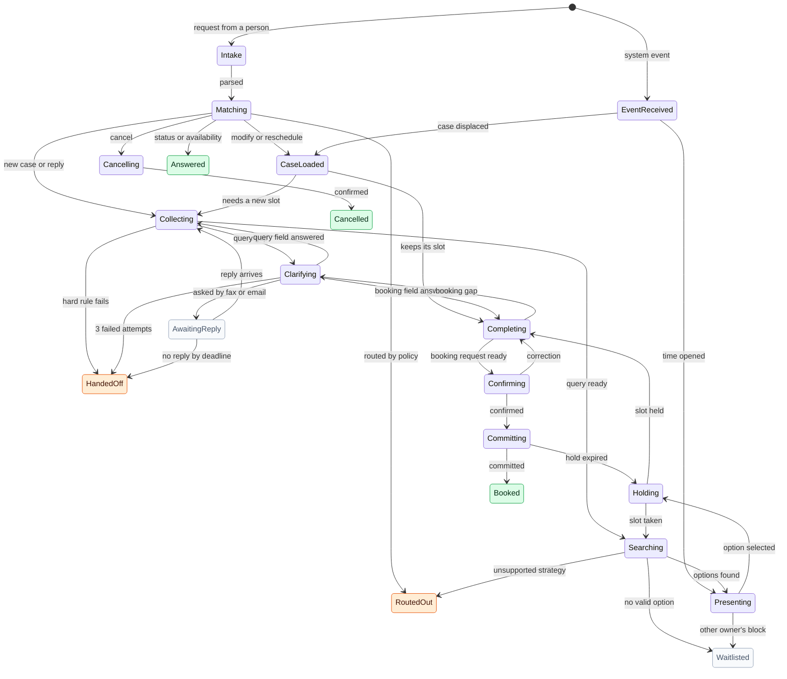
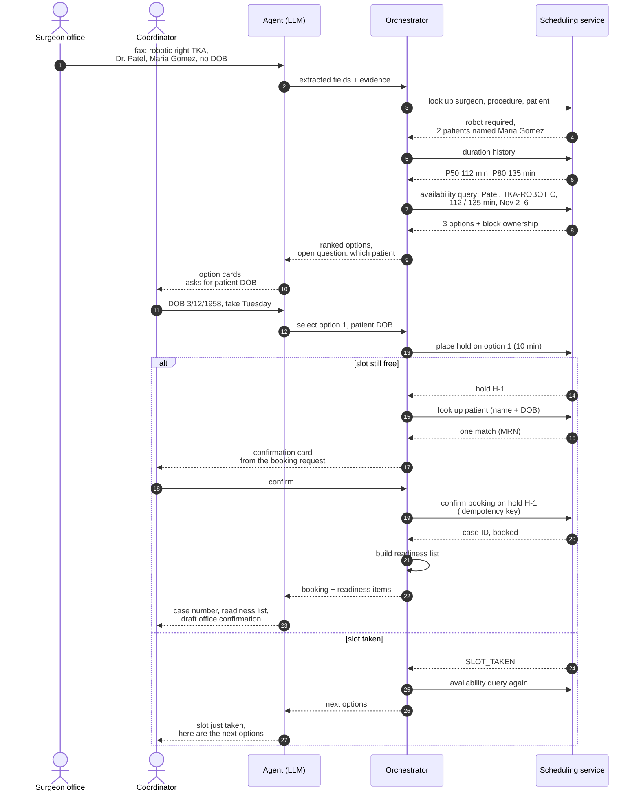
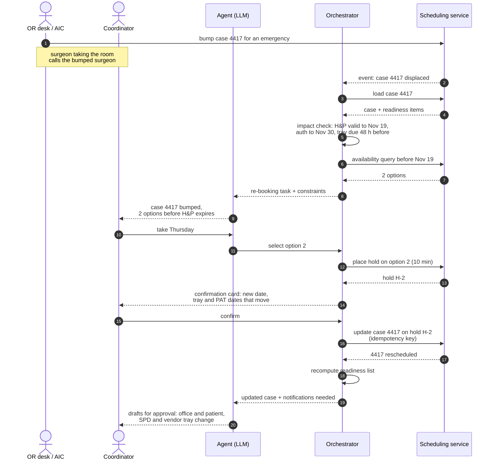

# Booking Flow

Five views of the same system:

1. **Intake and routing:** every kind of input and where it goes.
2. **Booking core:** the shared steps every schedule change runs through.
3. **Conversation state machine:** the states a request moves through and what moves it.
4. **Sequence, new request:** who calls whom when a faxed request becomes a booking.
5. **Sequence, bumped case:** who calls whom when a booked case is displaced and re-booked.

Inputs fall into five groups (see the [problem statement](../problem_statement.md#4-what-comes-in)): new cases, requests about an existing case, hospital or system events, continuations of an open request, and requests that route straight to a human.

**Color legend:** purple = language model (interprets, communicates) · blue = deterministic rules (decide) · green = scheduling service and lookups (act) · orange = human decision · gray dashed = waiting, downstream or not yet supported · dark blue = entry into the booking core.

Where a diagram routes something to a person (the AIC and OR desk for urgent requests, the surgeon's office for clinical questions, the block owner for a release request), that destination is the simulated hospital's **default policy**, not a fixed rule of the agent. The only fixed rules are the flow's own: every commit passes through confirmation and a commit-time re-check, model output enters a case only through lookup and validation, and every step is recorded.

## 1. Intake and routing

Requests from people and events from the hospital or system enter separately. Anything that changes the schedule goes to the booking core through one of its entries. Everything else is answered read-only or routed to a human.

## 2. Booking core

All four entries converge on the same steps, in two halves. **Finding time:** the three query inputs are resolved, the case is sized, and the availability query returns options. **Booking it:** the moment the coordinator picks an option, a hold protects the slot for 10 minutes while the agent resolves the patient and completes the booking request; the commit is made against that hold. New cases enter through lookups. Existing and displaced cases enter through an impact check that works out what the change breaks, and skip intake because the case is already known.

## 3. Conversation state machine

Each request or re-booking task is one instance of this machine. Requests from people and events from the system enter at different points but share the same core states. `Collecting` gathers what the availability query needs; `Completing` gathers what the booking request needs, while `Holding` protects the chosen slot. `AwaitingReply` lets a request survive across channels and hours (any hold is released while it waits). `RoutedOut` covers escalation to the AIC or OR desk, declining clinical questions, and sending readiness updates downstream.

## 4. Sequence: a faxed request becomes a booking

The language model only interprets and phrases. The orchestrator owns every rule and renders the confirmation card from the validated booking request, so the card never comes from model prose. The hold goes on the moment the coordinator picks Tuesday, so the slot is protected while the patient is resolved and the card is confirmed.

## 5. Sequence: a bumped case is re-booked

The bump itself is a human decision, and the surgeon taking the room tells the bumped surgeon directly. The agent's work starts after that: it already knows the case, so it skips intake and goes straight to what the new date has to respect.

