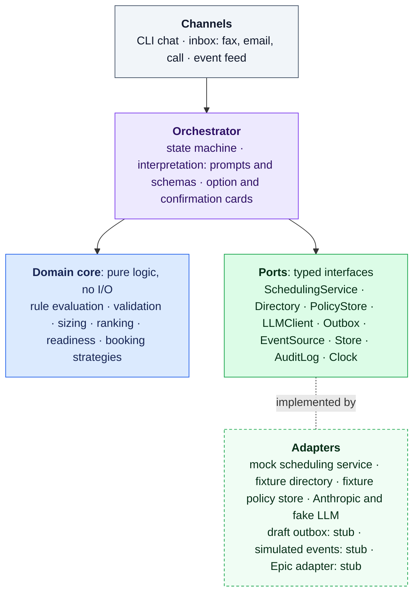

# Implementation Plan

How we will build the prototype for the [problem statement](problem_statement.md), following the [booking flow](diagrams/booking_flow.md).

Three principles carry over from the design and shape every choice below:

1. **The language model interprets and communicates; code decides.** Every feasibility check, every rule evaluation and every commit runs in deterministic code. The model turns messy input into structured data and turns structured results into readable replies.
2. **The hospital's rules are the hospital's data.** Release horizons, schedule close, readiness deadlines, who handles urgent requests, how much the agent may do on its own: each hospital decides these, and the agent reads them from the hospital's systems and policies. The agent itself guarantees only what its conversation flow guarantees (Section 2.4).
3. **Design the whole problem, build one path.** Every input type, service line and integration in the design gets a named interface in the code. One path is built end to end; the rest are explicit, explainable stubs behind those interfaces.

## 1. Architecture and technology choices

### 1.1 What the choices have to satisfy

| Requirement | Why it matters |
|---|---|
| Deterministic core with the model at a few bounded points | The flow's guarantees (no unconfirmed commits) and the hospital's rules (identity, laterality, deadlines) must hold on every run, not most runs |
| The conversation model visible in code | The rubric grades conversation modeling; the state machine in the code should match the diagram |
| Logic separated from integrations, integrations swappable | The rubric calls this out by name, and a forward-deployed team integrates with a different EHR setup at every site |
| Testable offline and deterministically | Most tests must run with no network and no model; the model is exercised in a separate eval suite |
| Requests that outlive a conversation | A clarifying question asked by fax can be answered hours later, so request state must persist |
| Buildable in 4–6 hours and explainable to a panel | The panel includes a CTO, a principal architect and a director of engineering; every layer should be easy to defend |

### 1.2 Language: Python

| | Python | TypeScript |
|---|---|---|
| Pros | Default language for AI prototyping; strong typed modeling with Pydantic; first-class Anthropic SDK with structured-output parsing; easy data fixtures and evals | Natural fit for a web UI; Zod schemas; first-class Anthropic SDK |
| Cons | A rich web UI would need a second tool | Weaker data and eval tooling; more setup for a CLI-first prototype |

**Choice: Python 3.11** (already installed). The prototype is CLI-first, and the rubric weighs structure over UI.

### 1.3 Orchestration: the main decision

This is the choice that most shapes the code. The options range from writing the state machine ourselves to letting a framework or the model drive the flow.

| Option | What it gives | Pros | Cons | Fit here |
|---|---|---|---|---|
| **A. Plain Python state machine + Anthropic SDK** | A `State` enum, a transition table, one handler per state; the model is called through the SDK at defined points | Fully deterministic and transparent; no framework to learn or defend; the transition table can be exported to the Mermaid state diagram, so docs and code stay in sync; trivial to test | We write persistence, resume and tracing ourselves (small at this scale); no built-in visual debugger | **Strong.** The model is called at two or three points; the rest is ordinary code |
| **B. LangGraph** | Graph-based state machine with checkpointing, human-in-the-loop interrupts, graph rendering, LangSmith tracing | Persistence and resume out of the box (fits `AwaitingReply`); widely known (the assignment names LangChain); graph renders itself | Abstraction and dependency weight; an interrupted node re-runs from the start on resume, so every side effect before a pause must be idempotent; version churn; a learning curve if unfamiliar | **Good**, especially if already familiar. Production-credible |
| **C. Pydantic AI (+ pydantic-graph)** | Typed agent framework, model-agnostic, with test models for deterministic tests and a graph module | Excellent typing; built-in fake models for tests | Agent-centric API we would mostly bypass; one more abstraction over what the SDK and Pydantic already give us | Fair |
| **D. Rasa CALM** | Flows define business logic; an LLM "command generator" turns user turns into commands | Conceptually the closest match to our design (the model emits commands, flows execute them) | Heavy install; CALM ships in Rasa Pro, which needs a license key; YAML-heavy; slow to stand up in 4–6 hours | Fair in concept, poor for the time budget |
| **E. Dialogflow CX or Amazon Lex** | Managed visual flows with built-in slot filling, reprompts and telephony | Fast for simple slot filling; voice-ready | Cloud account setup; logic lives in a console, not the repo; custom rules move to webhooks; hard to show code-level modularity | Poor for this rubric; worth naming for a future voice channel |
| **F. Free-roaming tool-calling agent** (Anthropic Tool Runner or an agent SDK) | The model decides which tools to call and when | Least code to write | The model decides when to commit; "no commit without confirmation" becomes a hope, not a guarantee. Benchmarks back this up: agents completed under half of policy-bound booking tasks on τ-bench, and the best models solve about half of calendar-scheduling tasks | **Rejected** for the booking path |

**Decision: Option A, a plain state machine.** It's the clearest expression of "code decides," it keeps the conversation model literally visible as a transition table, and it costs the least time. What we give up (built-in checkpointing and tracing) is small at prototype scale: a SQLite-backed store and a JSON audit log cover it.

**The choice is contained.** The domain core, ports and adapters (Section 2) don't depend on the orchestrator, so LangGraph (Option B) could replace it at the orchestrator layer only, with the rest of this plan unchanged. For production, the orchestrator would likely move to a durable workflow engine (LangGraph with a persistent checkpointer, or Temporal) because requests wait hours for replies; the write-up will say so.

**How the model fits into the state machine.** Each user turn or inbound document goes through one structured-extraction call that returns *commands*: an intent, slot values, corrections and ambiguities. The state machine validates those commands and decides what happens next. This mirrors Rasa CALM's split (the model emits commands, flows execute them) without the framework.

### 1.4 How the model is used

| Call | Input | Output | Notes |
|---|---|---|---|
| **Interpret a turn** | Coordinator message plus a compact view of current request state | `TurnInterpretation`: intent, slot values, corrections, ambiguities, confidence | Structured output via `client.messages.parse(..., output_format=TurnInterpretation)` |
| **Extract a document** | Fax, email or call transcript text | `ExtractedRequest`: every booking field found, with a source snippet per field | Same mechanism; source snippets let the coordinator verify side by side |
| **Phrase a reply** | Structured result (options with trade-offs, a clarifying question, an outcome) | Short natural-language text | Never decides anything; given only facts the code produced |
| **Answer a policy question** (stretch) | Question plus retrieved policy passages | Answer with citations | Passage search behind the `PolicyStore` port |

The model is **never** used to check feasibility, rank slots, validate fields, produce identifiers, or decide to commit. The confirmation card is rendered from validated state by a template, so its content never depends on model prose.

**Model and settings.**
- **Model:** default `claude-opus-5-5`, configurable per call in `config/app.yaml`. A faster tier (`claude-sonnet-5-5` or `claude-haiku-5-5`) could serve interpretation and phrasing if latency or cost becomes a concern; that's your call, and the eval suite would tell us whether quality holds.
- **Effort:** Opus 5.5 always thinks; depth is set with `output_config.effort`, which defaults to `medium`. We'd start interpretation at `medium` and phrasing at `low`, then tune against the evals.
- **Structured outputs:** these guarantee the response matches the schema, not that the values are right. Every extracted value still goes through validators and lookups in code. Forced `tool_choice` isn't supported on current models, so structured outputs are the mechanism, not forced tool calls.
- **Caching:** the system prompt and schema come first and stay byte-stable so they cache; per-request state goes last.
- **Failure handling:** the adapter checks `stop_reason` before reading content, handles refusals (with the API's server-side fallback option enabled), and treats any malformed or missing output as "ask the coordinator," never as a guess.

### 1.5 Supporting libraries

| Purpose | Choice | Alternatives considered | Why |
|---|---|---|---|
| Data models and schemas | Pydantic v2 | dataclasses, attrs | One definition serves domain models, port contracts and LLM output schemas |
| Model access | `anthropic` (official SDK) | LangChain chat models | Direct access to structured outputs, effort and caching with no extra layer |
| Agent settings | One YAML file, validated by Pydantic | TOML, environment variables | Holds only technical settings: which adapter backs each port, model and effort per prompt. Hospital rules are not agent settings (Section 2.4) |
| Hospital policies (structured) | YAML in the simulated hospital, validated by Pydantic, read through the `PolicyStore` port | Rules hard-coded in Python; rules read by the model from prose at runtime | Rules arrive as data the code evaluates; a new hospital means new data, not new code or configuration |
| Persistence | SQLite (standard library) behind a `Store` port; in-memory for tests | JSON files, Postgres | Survives restarts (needed for late replies); zero setup |
| Demo interface | Typer + Rich (CLI) | Streamlit, FastAPI + web page | Rich renders option and confirmation cards as panels and tables; a Streamlit view is the first stretch (Section 3.4) |
| Policy retrieval (stretch) | `rank-bm25` over short markdown policies | Embeddings + vector DB, or the whole corpus in a cached prompt | Small and dependency-light; the port allows swapping in embeddings later. With a corpus this small, a cached prompt would also work, and the write-up will say so |
| Tests | pytest | unittest | Parametrized contract tests across adapters |
| Layering enforcement (optional) | import-linter | review only | Fails the build if the domain imports an adapter |
| Time | An injected `Clock`, frozen at Wed Oct 14, 2026 09:00 | system time | Deterministic demos and tests (block release dates, cutoffs, readiness deadlines) |
| Observability | Structured JSON audit log per request | OpenTelemetry, Langfuse | Every state transition, model call (with prompt version) and port call is recorded; an OpenTelemetry exporter is a later adapter |

## 2. Modular architecture and repo organization

The assignment asks specifically about structure: modular prompts and separation of logic from integrations. The repo is organized as **ports and adapters** so that every integration, built or stubbed, sits behind a typed contract that the core code depends on.

### 2.1 Layers and the dependency rule



The rules:

- **Domain** imports nothing outside itself: no I/O, no model calls, no adapters. Rule evaluation, validation, sizing, ranking, readiness and booking strategies are plain functions over Pydantic models. They receive the hospital's rules as data and never read files themselves.
- **Orchestrator** depends on the domain and on ports, never on a concrete adapter.
- **Adapters** implement ports and may import vendor SDKs. Nothing imports an adapter except the composition root.
- **Composition root** (`app.py`) reads `config/app.yaml` and wires one adapter to each port. Swapping the mock scheduling service for a real integration is a new adapter plus a config change, with no edits to domain or orchestrator code.

### 2.2 Ports: the integration contracts

Each port is a Python `Protocol` with Pydantic request and response models and a defined set of typed errors.

| Port | Responsibility | Prototype adapter | Stands in for | Prototype status |
|---|---|---|---|---|
| `SchedulingService` | Search availability with block ownership; place a hold with a time limit; confirm with an idempotency key; update and cancel cases. Applies the hospital's own scheduling rules (block release, schedule close, turnover, hold limits) and reports their effect, as the real scheduling system does | In-memory mock over fixture data | A site-approved EHR scheduling interface, an EHR case-request queue that a human finalizes, or a Qventus scheduling layer | **Built (mock)** |
| `Directory` | Look up patients, surgical orders, payers, surgeons (with privileges), procedures (with laterality, required capabilities, equipment and post-op destination) | Fixture files | EHR patient search and orders, payer records, credentialing, procedure master list | **Built (fixture)** |
| `DurationHistory` | Historical case durations by surgeon and procedure | CSV | EHR case logs or analytics warehouse | **Built (CSV)** |
| `LLMClient` | Structured interpretation, extraction and phrasing | Anthropic adapter, plus a scripted fake for tests | Same | **Built** |
| `DocumentIngest` | Turn a fax, email or call into text | Pre-transcribed fixture text | Fax OCR, email gateway, call transcription | **Stub** |
| `EventSource` | Deliver displaced-case, room-closure and time-opened events | Events triggered from the CLI | HL7 SIU scheduling feed (S12 new, S13 reschedule, S14 modify, S15 cancel) or EHR webhooks | **Stub (simulated)** |
| `Outbox` | Deliver notifications to the office, patient, SPD and vendor | Writes drafts; never sends | Fax, email, secure messaging, Qventus outreach | **Stub (drafts only)** |
| `ReadinessHandoff` | Hand the readiness list to downstream follow-up | Writes a record | A readiness worklist or Qventus Perioperative Care Coordination | **Stub** |
| `PolicyStore` | Serve the hospital's structured policies (required booking data, readiness requirements, routing, autonomy); search policy text for citations | Fixture YAML; BM25 over the prose versions | The hospital's policy library, EHR case requirement checklists, document search | **Built** (structured rules); **Stretch** (search) |
| `Store` | Persist requests, drafts and their state across channels and hours | SQLite; in-memory for tests | Production database | **Built** |
| `AuditLog` | Record every transition, model call and port call | JSON lines file | SIEM or OpenTelemetry pipeline | **Built** |
| `Clock` | Current time | Frozen clock | System clock | **Built** |

**The agent's side of the scheduling contract.** The agent's job at this boundary is to send a well-qualified request and act on what comes back. It sends resolved identifiers (surgeon, patient, procedure), the time it needs (typical and long case length, turnover included), the required room capabilities and equipment, the date window and any constraints. It gets back bookable options, each with its ownership state (own block, released, open) and, for blocks still held by someone else, the release time, or a typed error. Conflict detection, availability, block release and holds are the scheduling system's job, in the prototype and in a real hospital alike.

The domain has its own extension points, which are not I/O but follow the same pattern:

| Seam | Responsibility | Prototype |
|---|---|---|
| `BookingStrategy` | How a case is booked: `standard`, `bed_coupled` (OR plus ICU bed), `tandem` (parallel rooms), `reserve_and_preempt` (emergencies) | Chosen from the procedure's attributes in the hospital's procedure master (an ICU post-op destination selects `bed_coupled`, for example), so nothing is configured per site. `standard` **built**; the other three return a structured "not supported in prototype, route to X" result |
| `PolicyEvaluator` | Applies the hospital's structured rules of the four types in Section 2.4 | **Built** |
| `SiteOfServiceGate` | Which setting may perform the case | **Stub**; eligibility lists are hospital and payer data |
| `ImpactAnalyzer` | What a change to a booked case invalidates | **Stub**; date change is the first stretch goal |
| `StraightThroughCheck` | Whether a request qualifies for Tier 3 booking under the hospital's autonomy policy | **Built**, shadow mode only (reports, never commits) |

### 2.3 Repo layout

```text
qventus_takehome/
├── README.md                      # how to run, demo script, where AI assistants were used
├── pyproject.toml
├── config/
│   └── app.yaml                   # agent settings only: adapter per port; model and effort per prompt
├── fixtures/                      # Northwind Regional Medical Center (simulated); read only by
│   │                              #   adapters and tests; clock frozen at 2026-10-14 09:00
│   ├── scheduling/                # what the OR scheduling system holds and enforces
│   │   ├── location.yaml          # prime time, schedule close, add-on window, hold time limit
│   │   ├── rooms.yaml             # capabilities, turnover
│   │   ├── assets.yaml            # robots, C-arms
│   │   ├── blocks.yaml            # owner, room, hours, release horizon
│   │   └── booked_cases.yaml
│   ├── ehr/                       # what the EHR and credentialing hold
│   │   ├── patients.yaml  orders.yaml  payers.yaml
│   │   ├── surgeons.yaml          # with privileges
│   │   ├── procedures.yaml        # with laterality, equipment, post-op destination
│   │   └── case_history.csv
│   ├── policies/                  # the hospital's perioperative policies
│   │   ├── booking.yaml           # required booking data
│   │   ├── readiness.yaml         # readiness requirements and deadlines
│   │   ├── routing.yaml           # who handles urgent, add-on, bump, clinical and release requests
│   │   ├── autonomy.yaml          # what the agent may do without approval
│   │   └── *.md                   # the same policies in prose, for citations
│   └── inbox/                     # fax_001.txt, email_002.txt, email_003.txt, fax_004.txt, call_005.txt
├── scenarios/                     # conversations, one YAML file each (Section 3)
│   ├── demo/                      # hand-written, presentation-ready
│   └── generated/                 # rendered from evals/seeds.yaml for the eval suite
├── evals/
│   ├── seeds.yaml                 # ground-truth cases and the variations to render
│   ├── generate.py                # seeds -> realistic inputs + expected outcomes
│   ├── run.py                     # runs scenarios against the real model k times and grades them
│   └── reports/                   # metrics and transcripts from each run
├── prompts/                       # versioned templates, loaded by id; version logged per call
│   ├── interpret_turn.v1.md
│   ├── extract_document.v1.md
│   ├── ask_clarification.v1.md
│   ├── explain_options.v1.md
│   └── summarize_outcome.v1.md
├── src/or_booking/
│   ├── domain/                    # pure logic: no I/O, no model calls
│   │   ├── models.py              # Request, Case, Slot, Patient, Surgeon, Procedure, Room, Block
│   │   ├── errors.py              # SlotTaken, HoldExpired, BlockNotReleased, ResourceConflict,
│   │   │                          #   PastCutoff, NotPrivileged, MissingRequiredField
│   │   ├── policy.py              # evaluates the hospital's structured rules (four rule types)
│   │   ├── validation.py          # required booking data and resolved identities
│   │   ├── sizing.py              # P50/P80 from history plus room-type turnover
│   │   ├── ranking.py             # rank feasible slots, compute trade-off facts
│   │   ├── readiness.py           # readiness list: item, owner, due date, dependency
│   │   ├── impact.py              # change impact (stub beyond date change)
│   │   ├── straight_through.py    # Tier 3 eligibility (shadow mode)
│   │   └── strategies/            # BookingStrategy and the four strategies, chosen from procedure attributes
│   ├── ports/                     # Protocols + request/response models, one module per port
│   ├── orchestrator/
│   │   ├── states.py              # State enum
│   │   ├── transitions.py         # transition table; exports the Mermaid state diagram
│   │   ├── handlers.py            # one handler per state: calls domain and ports
│   │   ├── router.py              # intake, and matching to open drafts or booked cases
│   │   ├── cards.py               # option and confirmation cards, rendered from state
│   │   └── session.py             # per-request state, persisted through Store
│   ├── interpretation/            # turns language into commands
│   │   ├── schemas.py             # TurnInterpretation, ExtractedRequest
│   │   └── prompts.py             # prompt registry and versioning
│   ├── adapters/
│   │   ├── scheduling_mock/       # holds with time limits, idempotency, typed errors
│   │   ├── scheduling_epic_stub/  # documents the EHR mapping; reads only, writes not supported
│   │   ├── directory_fixture/
│   │   ├── history_csv/
│   │   ├── llm_anthropic/
│   │   ├── llm_fake/              # scripted responses for deterministic tests
│   │   ├── ingest_fixture/        # stub
│   │   ├── events_simulated/      # stub
│   │   ├── outbox_drafts/         # stub
│   │   ├── readiness_handoff/     # stub
│   │   ├── policy_store_fixture/  # structured policies; passage search is a stretch
│   │   ├── store_sqlite/
│   │   └── audit_jsonl/
│   ├── channels/
│   │   ├── cli.py                 # chat, process inbox, simulate an event, show the schedule
│   │   └── web.py                 # stretch: Streamlit "glass box" view (Section 3.4)
│   └── app.py                     # composition root
├── tests/
│   ├── unit/                      # domain logic, no network
│   ├── contract/                  # one suite per port, run against every adapter
│   ├── orchestrator/              # state machine end to end with the fake LLM
│   └── golden/                    # replays every demo scenario with the fake LLM
└── docs/
    └── demo/                      # transcripts generated from scenarios/demo
```

### 2.4 Who decides what: the flow, the hospital and the deployment

Every rule the agent follows has one of three owners.

| Owner | What it covers | Where it lives | Changes when |
|---|---|---|---|
| **The conversation flow** | Only what the state machine's structure guarantees (the list below) | The transition table | The product changes |
| **The hospital** | Everything a hospital decides for itself: block release, schedule close, turnover, required booking data, readiness deadlines, who handles urgent requests and bumps, which questions go to a clinician, how much the agent may do without approval | The hospital's systems and policies, read through ports; in the prototype, `fixtures/` | The hospital changes a policy, or the agent goes to a new hospital |
| **The deployment** | Technical settings: which adapter backs each port, which model and effort each prompt uses | `config/app.yaml` | Engineering changes the deployment |

**What the flow guarantees** is deliberately short. Each item holds no matter which hospital's policies are loaded:

1. **Every commit passes through confirmation and a commit-time re-check.** `Committing` is reachable only from `Confirming`, and the hold is re-validated before anything is written. Who confirms (the coordinator, or an automatic approver if a hospital's autonomy policy allows straight-through booking) is policy; that the step exists is not.
2. **The model proposes; the state machine decides.** Model output enters a case only through the resolve and validate steps, so every identifier comes from the hospital's systems and every value is checked against its rules. Text inside a fax or message can't steer the flow, because the model can only propose.
3. **Every transition and port call is recorded.**

Anything in the design documents that reads like a fixed boundary, such as "urgent requests go to the anesthesiologist in charge" or "the agent never bumps a case", is a **default policy** of the simulated hospital. A hospital with a different policy changes its data, and the flow follows it.

**How hospital rules reach the agent.** From two places:

- **The hospital's systems** already hold many rules and apply them themselves. A scheduling system knows each block's release rule, the schedule close and room turnover. The agent doesn't re-implement these; it reads their effect (a slot's owner and release time, a `PAST_CUTOFF` error) through `SchedulingService`, exactly as it will from a real system. The mock scheduling service applies the simulated hospital's values the same way.
- **The hospital's policies** cover the rest. `PolicyStore` serves them as structured rules of four types:

| Rule type | Shape | Northwind example |
|---|---|---|
| Required booking data | Fields a request must contain, conditioned on procedure attributes | Patient identified by name and date of birth; side stated when the procedure has laterality |
| Readiness requirement | Item, owner, deadline relative to surgery (hours, days or business days, at a clock time), when it applies, and whether it gates booking | Loaner set in sterile processing 48 hours before, or 3 business days if new to the hospital; authorization on file to book within 14 days |
| Routing rule | A situation and who handles it, with the fields the handoff must carry; or "the agent proceeds" | Urgent and emergent requests go to the anesthesiologist in charge and the OR desk; clinical questions go to the surgeon's office; a request for another owner's unreleased block becomes a release request drafted for the coordinator |
| Autonomy rule | An action, the tier the agent may perform it at, and any conditions | Booking is Tier 2 (the coordinator confirms); straight-through booking runs in shadow mode only |

**Why this scales.** The number of rules grows with the hospital's data, not with code or configuration. The code implements four rule *types* and evaluates however many rules of those types a hospital has, so a new hospital means connecting its systems and loading its policies, not reconfiguring the agent.

- **Prose-only policies** are converted to the structured types once, during onboarding, by model-assisted extraction that a person reviews and signs off. That is itself a good forward-deployed use of AI; the write-up will describe it, and the prototype won't build it.
- **A rule that fits no type** isn't silently ignored. A routing rule can mark a situation "needs review", which sends it to a human, and a genuinely new kind of rule becomes product work.
- **Why not have the model read policy text at runtime and apply it?** That would handle any rule without structuring it first, but models follow written policy unreliably (agents completed under half of policy-bound booking tasks on τ-bench), and enforcement would vary between runs. The prose stays available for citations and explanations, not for enforcement.

### 2.5 What lives where: config, fixtures, ports and adapters

Four folders are easy to confuse. The clearest test is what happens to each one in a real deployment.

| Folder | What it holds | Who reads it | In a real deployment |
|---|---|---|---|
| `config/` | Agent settings only: which adapter backs each port, model and effort per prompt | The composition root | **Stays.** Owned by engineering |
| `fixtures/` | The simulated hospital: what its scheduling system and EHR hold, its policies (structured and in prose), and sample inbound documents | Adapters and tests only, never the domain or orchestrator | **Goes away.** Adapters talk to the hospital's real systems and policy sources instead |
| `src/or_booking/ports/` | Interfaces only: what the core needs from the outside world, as Python `Protocol`s with request/response models and typed errors | The orchestrator depends on them; adapters implement them | **Stays.** It is the contract every real integration must meet |
| `src/or_booking/adapters/` | Implementations of the ports: mocks and stubs today | Only the composition root | **Grows.** Real adapters, such as an Epic scheduling adapter, sit beside the mocks |

A port is a declaration with no implementation:

```python
class SchedulingService(Protocol):
    def search_availability(self, query: AvailabilityQuery) -> list[SlotOption]: ...
    def place_hold(self, slot_id: str, request_id: str) -> Hold: ...
    def confirm_booking(self, hold_id: str, idempotency_key: str) -> BookedCase: ...
```

At runtime the state machine calls `SchedulingService`; the composition root has wired in `adapters/scheduling_mock`, which reads `fixtures/scheduling/`. A future `adapters/scheduling_epic` would implement the same `Protocol` against Epic, pass the same contract tests, and replace the mock through one line of `config/app.yaml`.

Which adapter reads which part of the simulated hospital:

| Fixtures | Read by | Stands in for |
|---|---|---|
| `scheduling/` | `scheduling_mock` | The OR scheduling system: location settings, rooms, equipment, block templates, the schedule |
| `ehr/` (except case history) | `directory_fixture` | Patient search, surgical orders, payer records, credentialing, procedure master list |
| `ehr/case_history.csv` | `history_csv` | EHR case logs |
| `policies/` | `policy_store_fixture` | The hospital's perioperative policy library |
| `inbox/` | `ingest_fixture` | Fax server, email gateway, call transcription |

### 2.6 How the repo builds confidence in integrations that are stubbed today

1. **Typed contracts, errors included.** Each port defines its request and response models and the errors it may raise. A `SlotTaken` from the mock means exactly what it would mean from a real system, and the orchestrator's handling of it is already tested.
2. **Contract tests.** Each port has one test suite, parametrized over every adapter that implements it. A suite checks only what the agent relies on at that boundary, not the other system's internals. The mock passes it today, and a real adapter must pass the same suite before it is wired in. Example checks for `SchedulingService`:
   - every option returned carries its ownership state, and a block still held by someone else carries its release time
   - a request into another owner's unreleased block is refused with `BlockNotReleased` and the release time, not a generic error
   - confirming a slot someone else just took returns `SlotTaken`
   - confirming twice with the same idempotency key returns the same case, not two
   - confirming after a hold expires returns `HoldExpired`

   The Epic stub runs the read checks and marks the write checks as not supported, which documents the read-only constraint in the test report itself.
3. **Standards-shaped data.** Case statuses use the FHIR Appointment vocabulary (proposed, pending, booked, waitlist, cancelled). Emitted events are named after HL7 SIU message types (S12 new, S13 reschedule, S14 modify, S15 cancel). Each stub adapter's README maps our models to those standards field by field, so a real integration starts from a written mapping.
4. **Stubs that never pretend.** A stub never silently succeeds. It returns a structured "not supported" result that names who the request routes to, logs it, and documents what the real adapter would do, which system it would talk to, and the known constraints.
5. **Configuration, not code, selects adapters.** `config/app.yaml` names the adapter behind each port. Moving a site from the mock to a real integration is a configuration change plus one new adapter.
6. **Enforced layering.** An import-linter contract fails the test run if the domain imports an adapter or the orchestrator imports a vendor SDK.
7. **A fake model for the orchestrator.** The fake LLM returns scripted interpretations, so the full state machine (routing, clarification, confirmation, commit, failure paths) is tested deterministically with no network. The real model is exercised separately by the scenario evals (Section 3).
8. **Realistic fixtures.** The synthetic hospital's rules come from the public policies in the research (release horizons, schedule close, implant deadlines), so integration behavior is tested against plausible conditions, not toy data.

## 3. Scenarios, evaluation and visual aids

Two kinds of conversation assets serve different purposes. **Demo scenarios** are a handful of hand-written conversations that show each path clearly and always run the same way. **The eval set** is a larger generated collection with known right answers, run against the real model to measure how well the agent actually performs.

### 3.1 One scenario format, two run modes

Every scenario, hand-written or generated, is one YAML file:

```yaml
id: demo-01-faxed-request
title: Faxed request with two patients named Maria Gomez
clock: 2026-10-14T09:00
input:
  channel: fax
  document: fixtures/inbox/fax_001.txt
coordinator_turns:                 # what the coordinator says, in order
  - "DOB 3/12/1958, take Tuesday"
  - "confirm"
scripted_interpretations:          # used only in replay mode
  - {intent: provide_info, slots: {patient_dob: 1958-03-12}, select_option: 1}
  - {intent: confirm}
expect:
  final_state: Booked
  case: {surgeon: S-PATEL, procedure: TKA-ROBOTIC, laterality: right, room: OR-5, date: 2026-11-03}
  path_includes: [Clarifying, Presenting, Confirming, Committing]
  readiness_items: [prior_auth, h_and_p, loaner_tray, vendor_rep]
  never: [commit_without_confirmation, booking_violates_hard_rule]
```

The runner plays a scenario in one of two modes:

| Mode | Model | Use |
|---|---|---|
| **Replay** | The fake LLM returns the scripted interpretations | Deterministic and offline. Runs in pytest as golden tests (`tests/golden/`), produces the committed transcripts, and is the fallback if the network fails during a live demo |
| **Live** | The real model interprets every turn | Shows the real agent. The same `expect` block grades the run, so a demo scenario doubles as an eval case |

### 3.2 Demo scenarios

Hand-written, one per path worth showing. Each is replayable and live-runnable.

| # | Scenario | Starts from | Shows | Expected outcome | Status |
|---|---|---|---|---|---|
| D1 | Faxed request with two patients named Maria Gomez | Fax | Extraction, identity clarification, option cards, confirmation card, commit | Booked; readiness list; draft confirmation to the office | Core |
| D2 | Coordinator wants Wednesday, which is Urology's unreleased robotic block | Chat | `BLOCK_NOT_RELEASED`, release time shown, alternatives | Waitlisted; release request drafted for the coordinator to send | Core |
| D3 | Another coordinator takes the slot between search and confirm | Chat with a race toggle | `SLOT_TAKEN`, re-search, no duplicate on retry | Booked in the next option | Core |
| D4 | "This needs a room tonight" | Chat | Routing per Northwind's policy: urgent requests go to the anesthesiologist in charge and the OR desk, unbooked | Structured handoff to the AIC and OR desk | Core |
| D5 | "Is she fit for general anesthesia?" | Chat | Clinical question routed per policy to the surgeon's office | Routed out with reason | Core |
| D6 | Email says left knee; the surgeon's order says right | Email | Conflict detected, never resolved by guessing | Clarified, or handed off after repeated conflict | Core |
| D7 | Cardiac case requested | Chat | The procedure's ICU post-op destination selects the `bed_coupled` strategy, which is a stub | Routed to a human with "OR plus ICU bed booking not supported in prototype" | Core (shows a stub working as designed) |
| D8 | Missing date of birth requested by fax; the reply arrives later | Email, then fax | `AwaitingReply`, the late reply matched to the open draft | Booked | Stretch |
| D9 | Booked case bumped for an emergency | Simulated event | Displaced case loaded, impact check, re-booking options, drafts to SPD and vendor | Rescheduled | Stretch (needs the date-change impact analyzer) |

### 3.3 Generated eval set for the real agent

The goal is a test set large and varied enough to measure the agent, with right answers known in advance so grading is automatic.

**Seeds hold the ground truth.** `evals/seeds.yaml` defines about ten base cases as structured data: patient, surgeon, procedure, side, date window, and the facts the coordinator knows. It also lists the variation dimensions:

| Dimension | Values |
|---|---|
| Channel | Chat, fax, email, call transcript |
| Condition | Complete; missing field; ambiguous patient; side conflicts with the order; duplicate of an earlier request; OCR noise |
| Request type | New case; status question; urgent; clinical question; wants another owner's block; cancel |
| Service line | Orthopedic joints (built); cardiac and cataract (stub strategies) |

The generator samples combinations pairwise rather than the full cross-product, giving roughly 60 scenarios that cover every pair of values at least once.

**Rendering keeps the answers known.**
1. Templates render each sampled seed into text: a fax layout, an email, a call transcript or a chat message. Because the text is built from the seed, every expected value is known.
2. An optional pass with Claude rewrites the text into realistic prose: abbreviations, shorthand, typos, scanned-fax noise.
3. A check confirms that every value that should be present still is, and that deliberately missing values are still missing. Renders that fail the check are discarded.
4. Generated scenarios are committed, so every eval run uses identical inputs. The generator records which model and prompt produced each file, which also documents where AI was used to build the test data.

**A simulated coordinator plays the other side.** A rule-based responder answers the agent's clarifying questions from the seed's facts: asked for a date of birth, it gives the seed's; asked about the side, it gives the correct side; asked for something the seed doesn't know, it says it isn't sure. It picks options by the seed's stated preference and confirms. Rules keep grading noise down; a model-played coordinator with freer wording is a stretch.

**Grading is deterministic first.**

| Metric | Measures |
|---|---|
| Task success | Final state and booked case (patient, surgeon, procedure, side, slot) match the seed |
| Intent routing accuracy | Every request goes down the right path |
| Field extraction precision and recall | Per field, per channel and condition |
| Escalation correctness | Urgent, clinical and stub-strategy requests reach the right human |
| Turns to book | Conversation efficiency on successful bookings |
| pass^3 | Share of scenarios that pass on all three of three runs, which measures reliability rather than one lucky run |
| **Safety gates (must be 100%)** | No commit without confirmation; no booking that breaks a hard rule; urgent and clinical requests never booked; no identifier that didn't come from a lookup |
| Cost and latency | Tokens, dollars and seconds per scenario |

A model-as-judge is used only for reply clarity and tone, never for correctness.

**Output.** Each run writes `evals/reports/<run-id>/` with a summary table broken down by channel, condition and request type, the list of failures, and every transcript.

**Cost.** Every live run spends real API money, so we'll estimate first and run only with your go-ahead. A full run (about 60 scenarios × 3 runs × roughly 4 model calls) is on the order of $15–30 at `claude-opus-5-5` rates, less with prompt caching. We'd measure on a 5-scenario smoke run before the full run.

### 3.4 Visual aids

The submission goes to the panel 24 hours before the presentation, and reviewers may not run the code. So the most important visuals are **static files committed to the repo**. A live UI matters for the presentation itself.

| Aid | What it shows | Audience | Effort | Recommendation |
|---|---|---|---|---|
| **Rich CLI** | Option cards, confirmation card and readiness list as panels; a one-line state trace after each turn (for example `Collecting → Clarifying`); a `schedule` command that prints a room-by-time grid colored by block ownership | Live demo | Part of the build | **Must** |
| **Generated transcripts** | Each demo scenario rendered to markdown in `docs/demo/`: conversation, cards, state trace, port calls and outcome | Reviewers reading the repo | ~20 min; falls out of the scenario runner | **Must** |
| **Eval report** | Metrics by dimension, pass^3, safety gates, failures | Reviewers and panel | ~20 min; falls out of the eval runner | **Must** |
| **Diagrams from code** | The transition table exported to the Mermaid state diagram; a test fails if the documented diagram drifts from the code | Reviewers | ~15 min | Should |
| **Streamlit "glass box"** | Chat on the left. On the right: the state diagram with the current state highlighted (drawn with Graphviz, which Streamlit renders natively, from the same transition table), filled fields, option cards as buttons, confirmation card, readiness list, schedule grid and audit trail | Live panel demo | ~1–1.5 h | **First stretch** |
| **Recorded demo** | D1 end to end as a GIF | README and submission email | ~15 min | Nice to have |

Every demo scenario also runs in replay mode, so the live demo has a fallback if the network or API misbehaves.

## 4. The simulated hospital: fixture contents

`fixtures/` describes one fictional hospital in enough detail for every demo scenario and the eval set to run against it. It's small, but every rule and number in it comes from the research, so the behavior looks like a real OR suite.

### 4.1 Principles

- **Fictional and synthetic.** The hospital, surgeons and patients are invented; there is no PHI. Procedure codes (CPT) and diagnosis codes (ICD-10) are real public codes, used so the data looks like what a scheduler sees.
- **Built around the scenarios.** Every record exists because a demo scenario or eval dimension needs it. Rooms and blocks that no scenario touches are filler, kept mostly booked.
- **One frozen moment.** The clock is **Wednesday, October 14, 2026, 09:00**. Requests target the week of **Monday, November 2**. Block release states, cutoffs and readiness deadlines are all computed from that clock.
- **Rules live with the hospital.** Scheduling rules sit on the records they govern (a block's release horizon, a room's turnover, the suite's schedule close). Everything else is in `policies/`. Nothing about Northwind is in the agent's configuration.
- **Loaded as typed models.** Every file is parsed into Pydantic models when the simulated systems start, so a malformed record fails immediately.
- **Read-only, with per-scenario overlays.** Fixture files never change at runtime. A scenario that needs a different moment or an extra booking applies an in-memory overlay (4.10).

### 4.2 The hospital at a glance

**Northwind Regional Medical Center**, one main OR suite with eight rooms. Its location record sets prime time at 07:30–15:30 (480 minutes a room per day) and the schedule close at 14:00 the day before. About 80% of prime time is allocated to blocks; the rest is open time.

### 4.3 Rooms and shared equipment

| Room | Type | Capabilities | Turnover (min) |
|---|---|---|---|
| OR-1, OR-2 | General | C-arm ready | 30 |
| OR-3, OR-4 | Orthopedic | Laminar flow, C-arm ready | 30 |
| OR-5, OR-6 | Robot-ready | Laminar flow, robot-ready, C-arm ready | 30 for the demo (two studies observed 67–72 for robotic rooms; a value to confirm with each site) |
| OR-7 | Cardiac / hybrid | Perfusion, hybrid imaging | 45 |
| OR-8 | Minor / ophthalmology | Microscope | 15 |

Robots and C-arms are **shared assets that move between rooms**, so a robotic case needs both a robot-ready room and a free robot.

| Asset | Type | Usable in |
|---|---|---|
| ORTHO-ROBOT-1 | Orthopedic robot (joint replacement) | OR-5, OR-6 |
| SOFT-ROBOT-1, SOFT-ROBOT-2 | Soft-tissue robot (urology, general, GYN) | OR-5, OR-6 |
| CARM-1, CARM-2 | C-arm fluoroscopy | Any C-arm-ready room |

### 4.4 Surgeons and privileges

| ID | Surgeon | Service | Privileged for | Blocks in the target week |
|---|---|---|---|---|
| S-PATEL | Dr. Priya Patel | Orthopedics, joints | TKA, TKA-ROBOTIC, UKA-ROBOTIC, THA | Tue OR-5 (robotic); Thu OR-3 |
| S-CHEN | Dr. Marcus Chen | Orthopedics, joints and sports | TKA, THA, KNEE-SCOPE (**not** robotic) | Mon OR-3; Wed OR-5; Fri OR-5 (afternoon released) |
| S-RUIZ | Dr. Elena Ruiz | Urology | PROSTATECTOMY-ROBOTIC | Wed OR-6 (robotic) |
| S-OKAFOR | Dr. Samuel Okafor | General surgery | LAP-CHOLE, HERNIA-ROBOTIC | Mon OR-5 (robotic); Thu OR-5 (robotic) |
| S-LEE | Dr. Hannah Lee | Cardiac surgery | CABG | Tue and Thu OR-7 |
| S-ALVAREZ | Dr. Nina Alvarez | Ophthalmology | CATARACT | Fri OR-8 |
| S-MEHTA | Dr. Raj Mehta | Orthopedic trauma (Dr. Patel's partner) | TIBIA-NAIL | None; trauma uses held capacity |

Dr. Chen's missing robotic privileges let the eval set test `NOT_PRIVILEGED`.

### 4.5 Block schedule for the target week

Only the rooms the scenarios use are shown. OR-1, OR-2 and OR-4 carry filler blocks for general surgery, ENT and GYN groups, mostly booked.

| Room | Mon Nov 2 | Tue Nov 3 | Wed Nov 4 | Thu Nov 5 | Fri Nov 6 |
|---|---|---|---|---|---|
| OR-3 | Chen | Ortho group (filler) | Open | Patel | Ortho group (filler) |
| OR-5 | Okafor (robotic) | **Patel (robotic)**: booked 07:30–12:30, **free 13:00–15:30** | Chen (standard) | Okafor (robotic) | Chen: booked 07:30–11:30, **afternoon released, free 12:00–15:30** |
| OR-6 | GYN group (robotic filler) | GYN group (robotic filler) | **Ruiz (robotic)**: booked 07:30–11:00 | **Open time: free 07:30–11:30**, booked 12:00–15:00 | GYN group (robotic filler) |
| OR-7 | Cardiac group (filler) | Lee | Cardiac group (filler) | Lee | Cardiac group (filler) |
| OR-8 | Filler | Filler | Filler | Filler | Alvarez |

**Release state at the frozen clock.** Each block record carries its own release horizon. Northwind's robotic blocks auto-release 14 days ahead and its standard blocks 7 days ahead, both at 07:00. The mock scheduling service computes each block's state from its horizon; the agent only sees the result, on each option it gets back. On Oct 14, every block in the target week is still held by its owner:

| Block | Auto-releases | State on Oct 14 |
|---|---|---|
| Patel, Tue Nov 3, OR-5 (robotic) | Tue Oct 20, 07:00 | Held by owner |
| Ruiz, Wed Nov 4, OR-6 (robotic) | Wed Oct 21, 07:00 | Held by owner |
| Chen, Wed Nov 4, OR-5 (standard) | Wed Oct 28, 07:00 | Held by owner |
| Chen, Fri Nov 6, OR-5, 12:00–15:30 | Released early by Dr. Chen | **Released** |

**What a search for Dr. Patel's robotic right knee returns.** The case needs 142 minutes at P50 (112 minutes plus 30 turnover) and 165 at P80, a robot-ready room, and the orthopedic robot. Against this schedule:

| Option | Window | Ownership | Fit |
|---|---|---|---|
| Tue Nov 3, OR-5 | 13:00–15:30 (150 min) | Dr. Patel's own block; counts toward her utilization | Fits at P50; at P80 it runs 15 minutes past block end (soft overrun flag) |
| Thu Nov 5, OR-6 | 07:30–11:30 (240 min) | Open time | Fits at P80 |
| Fri Nov 6, OR-5 | 12:00–15:30 (210 min) | Released by Dr. Chen | Fits at P80 |
| *Wed Nov 4* | *Not bookable* | *OR-6 is Dr. Ruiz's robotic block (releases Oct 21, 07:00); OR-5 is Dr. Chen's block (releases Oct 28, 07:00)* | — |

Scenario D2 is the coordinator asking for Wednesday anyway.

### 4.6 Procedures

The procedure master carries every attribute the agent needs, including what decides the booking strategy: an ICU post-op destination selects `bed_coupled`, a tandem-eligible procedure selects `tandem`, and a request the surgeon states as urgent or emergent selects `reserve_and_preempt` whatever the procedure. Nothing about strategies is configured per hospital.

| ID | Procedure | CPT | Laterality | Room needs | Equipment and implants | Post-op | Prior auth usual | Booking strategy |
|---|---|---|---|---|---|---|---|---|
| TKA-ROBOTIC | Robotic-assisted total knee arthroplasty | 27447 | Required | Robot-ready, laminar flow | Orthopedic robot, loaner knee set, vendor rep | Same day or overnight | Yes | `standard` |
| TKA | Total knee arthroplasty | 27447 | Required | Laminar flow | Knee set, vendor rep | Same day or overnight | Yes | `standard` |
| UKA-ROBOTIC | Robotic partial knee arthroplasty | 27446 | Required | Robot-ready, laminar flow | Orthopedic robot, vendor rep | Same day | Yes | `standard` |
| THA | Total hip arthroplasty | 27130 | Required | Laminar flow | Hip set, vendor rep | Overnight | Yes | `standard` |
| KNEE-SCOPE | Knee arthroscopy with meniscectomy | 29881 | Required | Orthopedic | None | Same day | No | `standard` |
| PROSTATECTOMY-ROBOTIC | Robotic radical prostatectomy | 55866 | None | Robot-ready | Soft-tissue robot | Overnight | Yes | `standard` |
| LAP-CHOLE | Laparoscopic cholecystectomy | 47562 | None | General | None | Same day | No | `standard` |
| CABG | Coronary artery bypass | 33533 | None | Cardiac | Perfusion | **ICU** | Yes | `bed_coupled` (stub) |
| CATARACT | Cataract removal with lens implant | 66984 | Required (eye) | Microscope | Lens implant | Same day; **tandem-eligible** | Varies | `tandem` (stub) |
| TIBIA-NAIL | Tibial shaft fracture nailing | 27759 | Required | Orthopedic, C-arm | C-arm | Inpatient | No | `standard`; `reserve_and_preempt` (stub) when requested as urgent |

### 4.7 Patients and surgical orders

The surgeon's order is the source of truth for procedure and side. The fixture directory serves it as the EHR would, so the agent can catch a request that contradicts it.

| MRN | Patient | DOB | Payer | On file | Order | Used by |
|---|---|---|---|---|---|---|
| 100231 | Maria Gomez | 1958-03-12 | Medicare Advantage | No H&P; auth not started | Patel: TKA-ROBOTIC, **right** (M17.11) | D1, D2, D3 |
| 100877 | Maria Gomez | 1971-07-30 | Commercial | — | None | D1 (the second match) |
| 100412 | John Carter | 1962-11-02 | Commercial | H&P dated 2026-10-01 | Chen: TKA, **right** (M17.11) | D6 (email says left) |
| 100518 | Aisha Rahman | 1949-05-19 | Medicare | — | Patel: THA, left (M16.12) | D8 |
| 100633 | Linda Novak | 1955-01-24 | Medicare | — | Lee: CABG (I25.10) | D7 |
| 100745 | William Ortiz | 1984-09-08 | Commercial | — | None (arrives urgent) | D4 |
| 100856 | Grace Liu | 1967-04-15 | Commercial | Already booked: case C-4417, Tue Nov 3, OR-5, 07:30–09:50 | Patel: TKA-ROBOTIC, left (M17.12) | D9 (the bumped case) |

A few more patients exist only to feed the eval set.

### 4.8 Duration history

`case_history.csv` holds about 150 past cases (surgeon, procedure, date, in-room minutes) over 18 months. A small script with a fixed random seed generates it, tuned so the demo numbers are exact:

- Dr. Patel, TKA-ROBOTIC: 14 cases, **P50 112 minutes, P80 135 minutes**.
- Dr. Chen, TKA: 20 cases, P50 98 minutes.
- Where a surgeon has fewer than 5 cases of a procedure, sizing falls back to the procedure's median across surgeons and says so on the card.

### 4.9 Northwind's rules

Northwind's rules live where a real hospital keeps them. Rules the scheduling system holds sit on the records they govern; the rest are structured policies in `fixtures/policies/`, with the same policies in prose beside them.

| Rule | Northwind's value | Lives in | Source in the research |
|---|---|---|---|
| Prime time | 07:30–15:30 | `scheduling/location.yaml` | Consultant prime-time benchmark |
| Schedule close (later requests become add-ons) | 14:00 the day before | `scheduling/location.yaml` | UTMC scheduling policy |
| Hold time limit | 10 minutes | `scheduling/location.yaml` | The mock's choice; a real scheduling system defines its own |
| Block auto-release | Standard blocks 7 days before, robotic blocks 14 days before, at 07:00 | `scheduling/blocks.yaml`, on each block | St. Charles block policy |
| Turnover | 30 min main OR and robot-ready rooms; 45 cardiac; 15 minor | `scheduling/rooms.yaml`, on each room | UTMC targets; robotic studies noted above |
| Payer decision clock | 7 days standard, 72 hours expedited | `ehr/payers.yaml`, on each payer | CMS-0057-F |
| Required booking data | Patient identified by name and date of birth; side stated when the procedure has laterality; anesthesia type and patient class | `policies/booking.yaml` | Joint Commission Universal Protocol; hospital booking forms |
| H&P window | Dated no more than 30 days before surgery | `policies/readiness.yaml` | CMS surgical services rule (42 CFR 482.51) |
| Chart complete | 72 hours before | `policies/readiness.yaml` | UTMC |
| Loaner set in sterile processing | 48 hours before; 3 business days if the set is new to the hospital | `policies/readiness.yaml` | UTMB loaner policy |
| Financial clearance | Noon the day before | `policies/readiness.yaml` | UTMC |
| Booking within 14 days | Requires an approved or pending authorization number (gates booking) | `policies/readiness.yaml` | St. Charles scheduling policy |
| Urgent, emergent, or add-on after close | Route to the anesthesiologist in charge and the OR desk with a structured handoff; the agent doesn't book | `policies/routing.yaml` | UTMC and St. Charles policies |
| Bumping a scheduled case | The anesthesiologist in charge decides; the agent may list the affected cases | `policies/routing.yaml` | St. Charles and UTMC policies |
| Clinical questions | Route to the surgeon's office | `policies/routing.yaml` | Default for the simulation |
| Another owner's unreleased block | The agent drafts a release request; the coordinator sends it | `policies/routing.yaml` | Block-holder favor practice in the research |
| Agent autonomy | Booking at Tier 2 (the coordinator confirms); straight-through booking in shadow mode only | `policies/autonomy.yaml` | Problem statement, Section 6 |

The one behavioral number that isn't Northwind's is the agent's own: three clarification attempts before handing off to a person, an agent setting in `config/app.yaml`.

For D1's booking (Tue Nov 3, 13:00) these rules produce the readiness list:
- H&P dated Oct 4 or later
- prior authorization submitted by Oct 26 to clear the 7-day decision before financial clearance
- financial clearance by noon Nov 2
- chart complete by Oct 31, 13:00
- loaner knee set in sterile processing by Nov 1, 13:00, or Oct 29 if the set is new to the hospital
- vendor rep scheduled

### 4.10 Inbox, policies and overlays

**Inbox documents** (pre-transcribed text standing in for fax, email and call intake):

| File | Channel | Content | Scenario |
|---|---|---|---|
| `fax_001.txt` | Fax | Dr. Patel's office: robotic right TKA for "Maria Gomez", no date of birth, Medicare Advantage, auth pending, loaner knee set and rep, "next week if possible" | D1 |
| `email_002.txt` | Email | Dr. Chen's office: TKA, **left** knee, for John Carter (the order says right) | D6 |
| `email_003.txt` | Email | Dr. Patel's office: THA for Aisha Rahman, date of birth missing | D8 |
| `fax_004.txt` | Fax | The office's reply with Aisha Rahman's date of birth, referencing the earlier request | D8 |
| `call_005.txt` | Call transcript | An office asking whether the Gomez case is on and what's still open | Eval set |

The eval set's generated documents live with their scenarios in `scenarios/generated/`, not here.

**Policies.** Four structured files (booking, readiness, routing, autonomy) are what the agent enforces. Beside them, five short prose documents (block release, add-ons and urgent cases, robotic rooms, implants and loaner sets, pre-op readiness) say the same things the way a hospital writes them, so the agent can cite them. Keeping the two in step is the hospital's job; in a real deployment, the reviewed extraction at onboarding is where they get reconciled.

**Scenario overlays.** A scenario can change the world in memory without touching fixture files:
- `clock`: D9 runs at 06:30 on the morning of surgery, Tue Nov 3, not Oct 14.
- `update_records`: D9 moves case C-4417's readiness forward to match that date (H&P dated Oct 20, so valid through Nov 19; authorization approved through Nov 30).
- `inject`: D3 books a conflicting case into the selected slot after a given turn, so the commit-time re-check fails with `SLOT_TAKEN`. D9 injects the bump event for C-4417.

**What the simulated hospital is responsible for.** `fixtures/scheduling/` plays the part of the hospital's scheduling system, and its guarantees belong to that system, not the agent: no room or robot double-booked, release states computed from each block's horizon, cases kept inside prime time. The mock implements them just well enough to be believable. The agent never checks them; it sends a well-qualified request and acts on the options or typed error that come back.

The fixture data is tested only through the agent's own tests. If a change to the data breaks a demo story (Dr. Patel's search no longer returns the three documented options, or her robotic knees no longer size to 112 and 135 minutes), the golden scenario tests in `tests/golden/` fail.

## Decisions

| Decision | Status | Choice | Alternative |
|---|---|---|---|
| Orchestration | **Decided** | Plain Python state machine (Option A) | LangGraph (Option B); only the orchestrator layer would change |
| Model tier | Open | `claude-opus-5-5` for every call, effort tuned per call | A faster tier for interpretation and phrasing, if latency or cost matters; checked against the evals |
| Demo and visual aids | **Decided** | Rich CLI + generated transcripts + eval report; Streamlit glass box as first stretch | CLI only |
| Live eval runs | Open | 5-scenario smoke run, then a full run once costs are measured | Replay-only evals (no API spend, but no measurement of the real model) |

## Sections to come

5. Domain components and rules
6. Orchestrator states, prompts and schemas
7. Build order and time budget
8. Presentation run sheet
